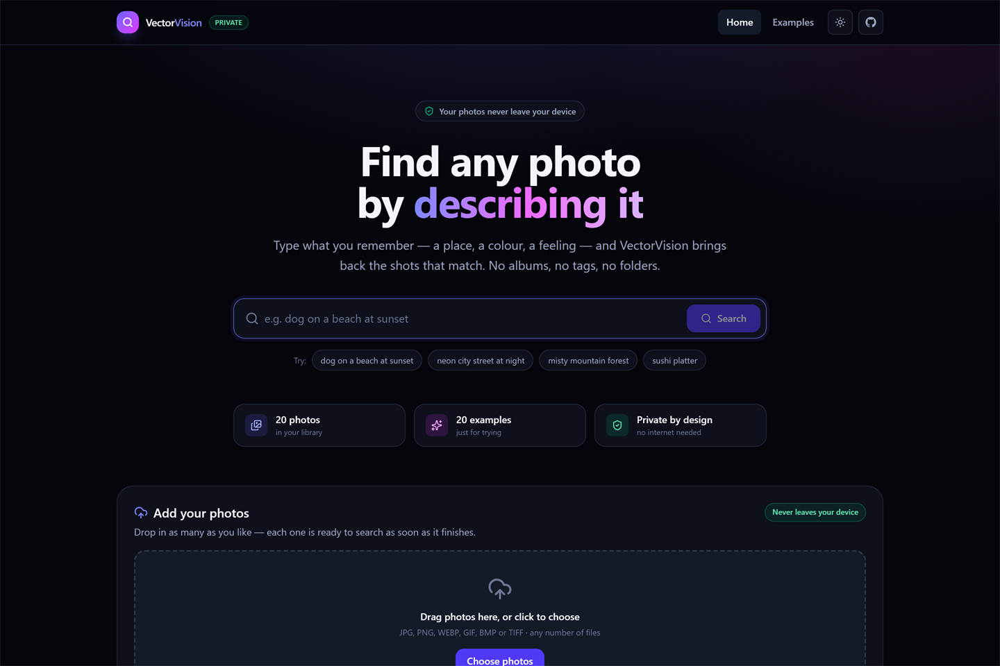
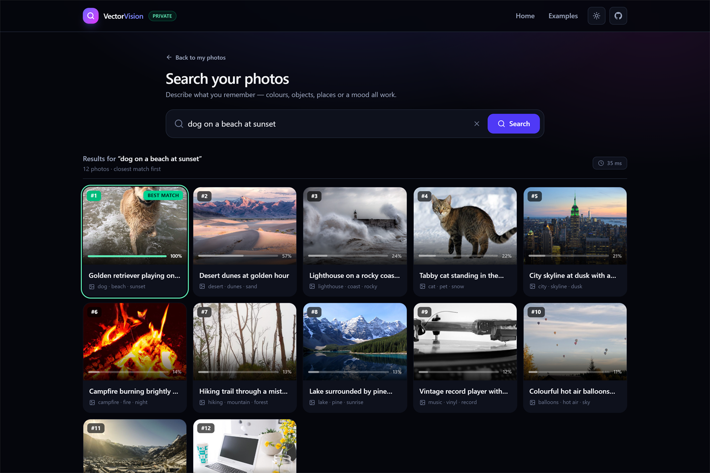
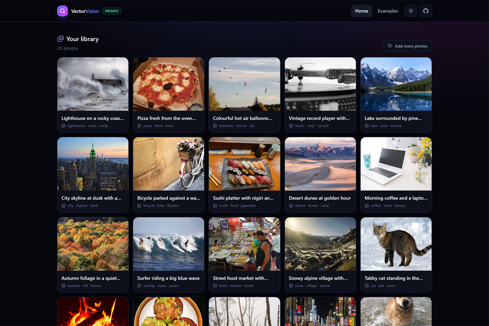
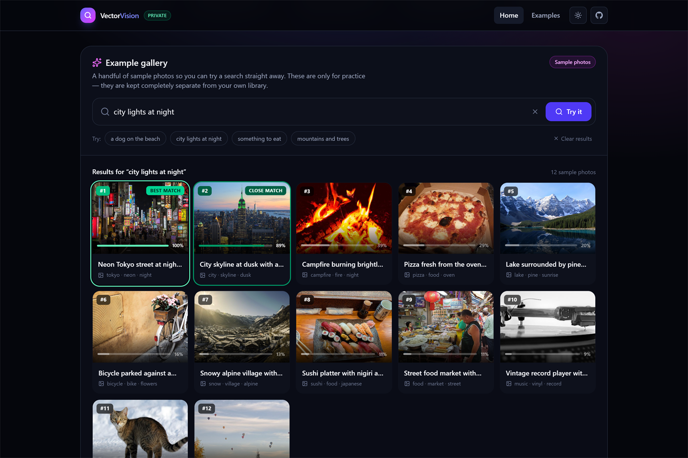

# VectorVision

**Find any photo on your computer by describing it.** Type *“dog on a beach at sunset”* and VectorVision brings back the shots that match — no albums, tags, folders, accounts or uploads.

[](https://github.com/CoresCode/VectorVision/releases/latest/download/VectorVision-Setup.exe)
-0ea5e9?style=flat-square)




## Why people use it

- **Search in your own words.** Colours, objects, places, moods — no keywords to memorise.
- **Nothing leaves your computer.** No account, no cloud, no telemetry. After the one-time setup it works with the network cable unplugged.
- **No organising.** Drop photos in; they are searchable as soon as they finish indexing.
- **Fast.** A typical search over a few hundred photos takes well under a second.
- **Honest results.** Match confidence is shown per photo, so you can see what is a close match and what is a guess.

## Download and install

1. Download **[VectorVision-Setup.exe](https://github.com/CoresCode/VectorVision/releases/latest/download/VectorVision-Setup.exe)** (47.1 MB, Windows 10/11 64-bit).
2. Run it. It installs for the current user only — **no administrator password and no UAC prompt**.
3. The installer is not code-signed yet, so Windows SmartScreen may say *“Windows protected your PC”*. Choose **More info → Run anyway**.
4. Launch VectorVision from the Start menu (or the optional desktop shortcut).

### First launch

The app needs its image-search model once. On first run it downloads about **292 MiB** from this repository's `models-v1` release, verifies every chunk with SHA-256, and caches the result. If the connection drops, the next launch resumes where it stopped — you never re-download finished parts.

After that, VectorVision makes **no network requests at all**.

## Using it

| | |
| --- | --- |
|  |  |
| **Search results** — ranked, with a confidence bar and green outlines for close matches. | **Your library** — everything you added, indexed locally. |

- **Add photos:** drag files onto the window or use *Choose photos*. JPG, PNG, WEBP, GIF, BMP and TIFF are supported.
- **Search:** describe the photo. Press Enter. Results are ordered by visual similarity.
- **Examples:** the app includes 20 sample photos so you can try a search before adding anything. They are kept separate from your own library.
- **Light/dark theme:** the sun/moon button in the header.
- **Enlarge a photo:** click any thumbnail.



## Privacy

- No sign-up, no login, no analytics, no crash reporting, no ads.
- Your photos are read from this computer and written to this computer. They are never uploaded.
- The local API only listens on `127.0.0.1`, on a random port, and refuses requests from other origins — a website you happen to visit cannot read your library.
- After the model download, the app works completely offline.

Your data lives in `%LOCALAPPDATA%\VectorVision`:

| Folder | What it holds |
| --- | --- |
| `data\photos` | your original photos (copies of what you added) |
| `data\thumbs` | thumbnails |
| `data\*.npy` | the local search index (rebuilt automatically if lost) |
| `models` | the cached model files |
| `logs` | a small local log for troubleshooting |

## Requirements

- Windows 10 or 11, 64-bit
- 4 GB RAM (8 GB recommended for large libraries)
- About 500 MB of disk space after the first run
- Internet access **once**, for the model download

## Uninstall

Use *Settings → Apps → VectorVision → Uninstall*. This removes the application only. Your photos, index and models stay in `%LOCALAPPDATA%\VectorVision`; delete that folder by hand if you want the space back (about 450 MB).

## Verify your download

| File | Size | SHA-256 |
| --- | --- | --- |
| `VectorVision-Setup.exe` | 47.1 MB | `aa095c404b0dc839f2e3bc9807c58c0f9bdf0fd423fc4116b1e9663db00d9361` |

```powershell
Get-FileHash .\VectorVision-Setup.exe -Algorithm SHA256
```

Model files are verified automatically during the first-run download, using the hashes published in the release's `manifest.json`.

## Frequently asked

**Does it upload my photos?** No. The app has no cloud component. You can confirm with any firewall or network monitor — after setup it stays silent.

**Do I have to pay or sign in?** No. It is free to download and use.

**Why is the installer 47 MB but the folder 131 MB?** The installer is compressed; the installed app contains the Python runtime, ONNX Runtime and the interface.

**Can I move my library?** Copy `%LOCALAPPDATA%\VectorVision\data` to the same path on the new machine; the app rebuilds the index on launch.

**Does it work on macOS or Linux?** Not today. This release is Windows-only.

**Is the source code available?** VectorVision is distributed as a Windows application; the source is not published. Third-party components and their licences are listed in [THIRD_PARTY_NOTICES.md](THIRD_PARTY_NOTICES.md).

## Licence

VectorVision is free to download and use. See [LICENSE](LICENSE) for the terms that apply to the application and this page. Third-party components remain under their own licences — see [THIRD_PARTY_NOTICES.md](THIRD_PARTY_NOTICES.md).

---

Made by [CoresCode](https://github.com/CoresCode). Questions or problems? [Open an issue](https://github.com/CoresCode/VectorVision/issues).
